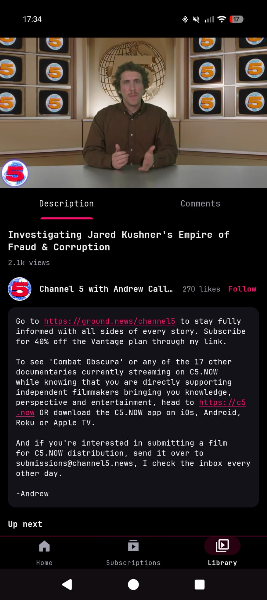
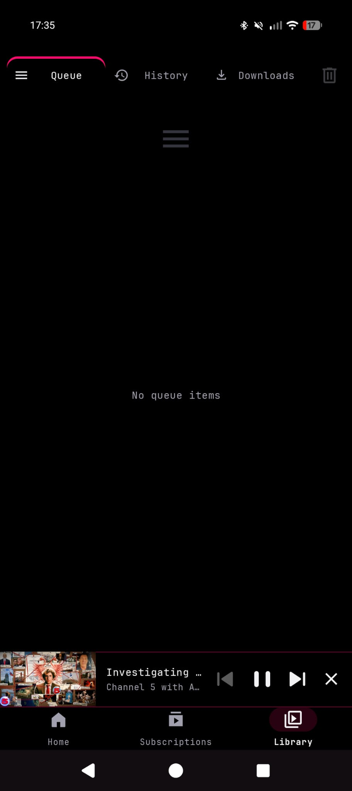

<h1 align="center">
  
  
  
</h1>

  in a world full of excess we give you 5 mb of simplicity

An ad-free YouTube client for Android. No account needed: Home, search, subscriptions, the queue
and history all work without logging in. Signing in is optional and only used if you want your own
YouTube subscriptions.

- **Ad-free playback**, with SponsorBlock skipping sponsor segments and an optional filter that
  hides AI-generated videos
- **Works with or without login.** Without one, Subscriptions shows the latest videos of the
  channels you follow; with one, your YouTube account's own subscriptions
- **Three themes:** Dark, Light and NiiX (black, dark glass with a pink edge, pink accents and
  JetBrains Mono), or follow the phone between Light and Dark
- **A player that keeps going:** background playback, picture-in-picture, and a player
  notification on the lock screen with previous, back 10 seconds, play/pause, forward 10 seconds,
  next and Close
- **Swipe the notification away and it closes**: the video stops, the app leaves the recent apps,
  and the cache is cleared if you want it to be
- **Local queue and history.** Swipe a video right to add it to the queue; watched videos are
  greyed out
- **Built-in downloader** for single videos and whole queues
- **Fast and light on data:** videos start before the rest of the page is in, Shorts load ahead,
  and streams use HTTP/3 where the phone supports it
- **Safe updates** from GitHub: only installed when the file matches GitHub's SHA-256 exactly and
  is signed with the same key as the app already on your phone
- **9 languages:** English, Spanish, French, Russian, Turkish, Japanese, Korean and Chinese
  (simplified and traditional)

Requires Android 8.0 or newer. Download the APK from
[Releases](https://github.com/techniixdotcom/testtube/releases); the app checks for updates
itself after that.

## How it works

Almost everything is native: the player, Home, Subscriptions, search, channel and playlist pages
(every channel tab), History, the queue, the screen under the video (description, comments and
suggestions) and the downloader are drawn by the app itself and get their data directly from
YouTube through the NewPipe Extractor. That makes it faster, smoother and fully under our control.

Only two small web views are left: the Google sign-in page, which can only open Google's and
YouTube's own sites, and the live chat of live streams. There is no YouTube website layer, no
injected scripts and no page bridge.

## Privacy

- **No analytics, crash reporting or ads.** History, the queue and the channels you follow stay on
  the phone, and Android backups are off.
- **SponsorBlock** only gets the first 4 characters of a SHA-256 hash of the video ID
  (sponsor.ajay.app), so it can't tell which video you're watching. There are no dislike-count
  lookups.
- **Hide AI videos** (off by default) downloads the community AiSList from
  raw.githubusercontent.com once a day. Nothing about you is sent.
- **Update checks** ask GitHub (api.github.com) for new releases 5 seconds after the app starts,
  including test versions if "Pre-releases" is on, and updates download from github.com. Nothing
  about you is sent. To switch checks off, tap the TestTube logo on Home and turn off "Check for
  updates automatically" under Updates.

## What it can't do

- **It can't hide you from YouTube.** YouTube and Google still see your IP address and the videos
  you watch, as with any YouTube client.
- **YouTube changes can break playback** until TestTube gets an update for them.
- **No casting** to a TV or Chromecast, and it's **Android only**.
- **On Android 13 and older a playing notification can't be swiped away**; pause first, or tap
  Close.

## The Look

  
  
  
  

## Building it yourself

On Linux, macOS or WSL2, run `./BUILD.sh` and pick from the menu. It downloads the JDK and
Android SDK it needs (checking their checksums), creates your signing key the first time, and puts
the APK in `dist/`. `./BUILD.sh --help` lists every option.

## Licence

TestTube is free software under the GNU General Public License version 3: you can use, study,
change and share it, and anything you distribute built from it must stay free under the same terms.
NewPipe Extractor is GPL-3.0-or-later. It comes with no warranty. The full text is in
[`LICENSE`](LICENSE).

  Peace and Love 
  techniix / cuteLiLi / QuacK / decoi

