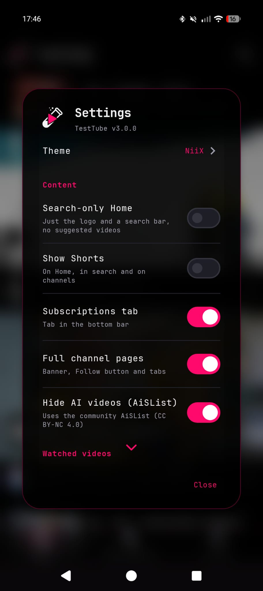

<h1 align="center">
  
</h1>

  in a world full of excess we give you 7mb of simplicity

An ad-free YouTube client for Android. No account needed: Home, search, subscriptions, the queue
and history all work without logging in. Signing in is optional and only used if you want your own
YouTube subscriptions.

- **Ad-free playback**, with SponsorBlock skipping sponsor segments and an optional filter that
  hides AI-generated videos
- **Works with or without login.** Without one, Subscriptions shows the latest videos of the
  channels you follow; with one, your YouTube account's own subscriptions
- **Three themes:** Dark, Light and NiiX (black, dark glass with a pink edge, pink accents and
  JetBrains Mono), or follow the phone between Light and Dark
- **A player that keeps going:** background playback, picture-in-picture, and a player
  notification on the lock screen with previous, back 10 seconds, play/pause, forward 10 seconds,
  next and Close
- **Swipe the notification away and it closes**: the video stops, the app leaves the recent apps,
  and the cache is cleared if you want it to be
- **Local queue and history.** Swipe a video right to add it to the queue; watched videos are
  greyed out
- **Playlists and Watch later, on the phone.** Long-press a video and tap Save; they're in
  Library > Playlists with Play all and Shuffle, and can be exported to another phone
- **Built-in downloader** for single videos and whole queues
- **Fast and light on data:** videos start before the rest of the page is in, Shorts load ahead,
  and streams use HTTP/3 where the phone supports it
- **Safe updates** from GitHub: only installed when the file matches GitHub's SHA-256 exactly and
  is signed with the same key as the app already on your phone
- **9 languages:** English, Spanish, French, Russian, Turkish, Japanese, Korean and Chinese
  (simplified and traditional)

Requires Android 8.0 or newer. Download the APK from
[Releases](https://github.com/techniixdotcom/testtube/releases); the app checks for updates
itself after that.

### Two editions

Every release has two APKs. Pick one; either installs over the other and keeps your history and
settings.

- **TestTube** (`testtube<version>.apk`): YouTube, nothing else.
- **TestTube+** (`testtubeplus<version>.apk`): YouTube, plus links people send you from
  **Spotify**, **Facebook** and **SoundCloud**. A Spotify song, album or playlist plays from YouTube
  (Spotify's own audio only plays in Spotify). Public Facebook videos and SoundCloud songs, sets and
  albums play in the player itself, just like YouTube videos: no ads, background play, minimized or
  in the floating window, the notification and the queue; when one ends, the queue goes on, or
  autoplay picks a YouTube video like it. There's no browsing, searching or account on those sites:
  only the links.

On Android 12 and newer, Android asks you once to let the app open links (Settings, Apps,
TestTube, Open by default); the app takes you there on its first start.

How it works, how to build it, and the full documentation:
[`docs/HOW-IT-WORKS.md`](docs/HOW-IT-WORKS.md).

## What it can't do

- **It can't hide you from YouTube.** YouTube and Google still see your IP address and the videos
  you watch, as with any YouTube client.
- **YouTube changes can break playback** until TestTube gets an update for them. The same goes
  for Facebook in TestTube+, which changes its pages often. Private, friends-only and group
  Facebook videos never play: TestTube+ doesn't log in to Facebook.
- **A Spotify song is matched on YouTube**, usually the right one but not always (a live take or
  a cover can come up); when nothing is close enough, you get YouTube's search results instead.
  The same goes for SoundCloud songs that SoundCloud only has as a 30-second preview (Go+).
  SoundCloud can also break playback with a change on its side, until TestTube+ is updated.
- **No casting** to a TV or Chromecast, and it's **Android only**.
- **On Android 13 and older a playing notification can't be swiped away**; pause first, or tap
  Close.

## The Look

  
  
  
  

## Licence

TestTube is free software under the GNU General Public License version 3: you can use, study,
change and share it, and anything you distribute built from it must stay free under the same terms.
NewPipe Extractor is GPL-3.0-or-later. It comes with no warranty. The full text is in
[`LICENSE`](LICENSE).

  Peace and Love 
  techniix / cuteLiLi / QuacK / decoi

